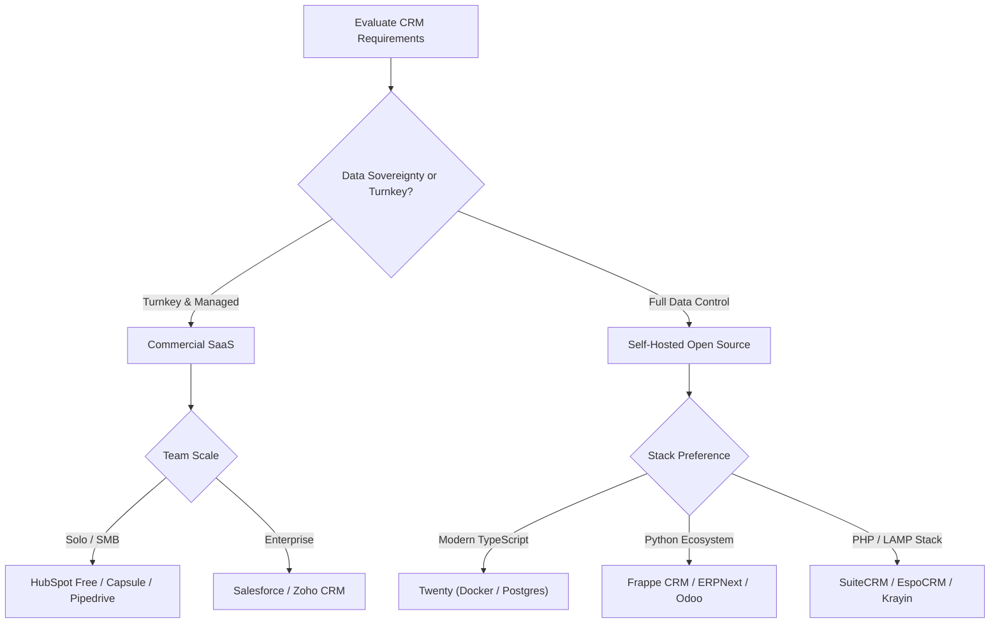

<p align="center">
  
</p>

# 🌟 Awesome Contact & Account Management

[](https://awesome.re)
[](LICENSE)
[](https://github.com/ishandutta2007/Awesome-Contact-Account-Management/pulls)
[](https://github.com/ishandutta2007/Awesome-Contact-Account-Management/graphs/commit-activity)

> 🚀 **The definitive curated index of Customer Relationship Management (CRM) tools, Contact & Account Management software, and self-hosted sales platforms.**  
> *Targeted insights for sales teams, revops engineers, account executives, founders, and developers seeking top SaaS services or open-source self-hosted solutions.*

---

## 📑 Table of Contents
- [🔍 Sector Overview & Market Dynamics](#-sector-overview--market-dynamics)
- [🏢 SaaS & Hosted Platforms](#-saas--hosted-platforms)
- [💻 Open-Source GitHub Projects](#-open-source-github-projects)
- [🛠️ Architecture & Deployment Guide](#-architecture--deployment-guide)
- [🤝 How to Contribute](#-how-to-contribute)
- [⚖️ Disclaimer & Compliance](#-disclaimer--compliance)

---

## 🔍 Sector Overview & Market Dynamics

The global Customer Relationship Management (CRM) and contact management software market is estimated at **$80B–$128B** (scaling past **$230B+ by the early 2030s** at an approximate ~10–12% CAGR). The sector is **moderately fragmented**: enterprise titan Salesforce commands roughly 20% of the worldwide revenue footprint, while the remaining ~80% is vigorously contested by a vibrant ecosystem of mid-market CRM giants (HubSpot, Zoho, Freshworks) alongside nimble point-solutions and self-hosted open-source alternatives.

---

## 🏢 SaaS & Hosted Platforms

A comprehensive, transparent breakdown of commercial contact and account management SaaS providers. Sorted by company scale (annual revenue / institutional valuation, descending).

| Product | Company Scale (Revenue / Valuation) | Description | Starting Pricing (Specific Tier) | Free Tier / Trial Specific Limits |
|:---|:---|:---|:---|:---|
| **[Salesforce Sales Cloud](https://www.salesforce.com/)** | 📈 ~$41.5B–$43.9B ARR / ~$185B Market Cap | Enterprise standard for CRM, account hierarchy mapping, opportunity tracking, and autonomous AI agents (Agentforce). | **$25/user/month** (Starter Suite, billed annually) | **Free Suite**: Permanent free tier for up to 2 users with core contact/account management; **30-day free trial** for Pro/Enterprise tiers. |
| **[HubSpot Sales Hub](https://www.hubspot.com/)** | 📈 ~$3.4B–$3.5B ARR / ~$28B Market Cap | Inbound sales platform featuring contact records, pipeline management, automated sequences, and smart conversation intelligence. | **$15/seat/month** (Sales Hub Starter, billed annually) | **HubSpot Free Tools**: Permanent $0 tier for up to 5 users, 1M contacts, basic deal pipelines, and email tracking; **14-day free trial** for paid tiers. |
| **[Zoho CRM](https://www.zoho.com/crm/)** | 📈 ~$1.4B–$1.5B Revenue / ~$12.5B Valuation | Bootstrapped ecosystem CRM providing omnichannel contact records, AI forecasting (Zia), and deep multi-app workflow automations. | **$14/user/month** (Standard edition, billed annually) | **Free Edition**: Permanent $0 tier for up to 3 users with basic contact management, leads, accounts, and mobile app; **15-day free trial** for paid editions. |
| **[Freshsales](https://www.freshworks.com/crm/)** (Freshworks) | 📈 ~$900M ARR / ~$3.2B Market Cap | Modern CRM combining contact and account intelligence with deal pipeline management and Freddy AI analytics. | **$9/user/month** (Growth plan, billed annually) | **Free Plan**: Permanent $0 tier for up to 3 users with built-in chat, email, phone, and contact lifecycle stages; **21-day free trial** for paid plans. |
| **[Pipedrive](https://www.pipedrive.com/)** | 📈 ~$180M–$210M ARR / ~$1.5B Valuation | Sales-centric pipeline and contact management CRM focusing on activity-based selling and visual deal progression. | **$14/user/month** (Lite tier, billed annually) | **14-day free trial** (no credit card required, unlimited contact/deal testing during trial period); no permanent free tier. |
| **[Copper](https://www.copper.com/)** | 📈 ~$35M–$41M ARR / ~$102M Total Funding | Native Google Workspace CRM embedded into Gmail, Google Calendar, and Drive for zero-friction account relationship logging. | **$29/user/month** (Basic plan, billed annually, max 3 seats) | **14-day free trial** (unrestricted access to contact auto-sync and email history, no credit card required); no permanent free tier. |
| **[Insightly](https://www.insightly.com/)** | 📈 ~$15M–$37M ARR / ~$40M Total Funding | Unified CRM connecting contact and account management directly to project delivery workflows and post-sale milestone tracking. | **$29/user/month** (Plus plan, billed annually) | **Free Plan**: Permanent $0 tier for up to 2 users and 2,500 contact records; **14-day free trial** for paid plans (no credit card required). |
| **[Close](https://close.com/)** | 📈 ~$13M–$15M ARR / Bootstrapped SMB Leader | High-velocity outbound sales CRM equipped with integrated VoIP calling, multi-channel SMS, and automated email sequences. | **$19/user/month** (Solo tier, billed annually) | **14-day free trial** (fully functional trial including test credits for VoIP calling and SMS, no credit card required); no permanent free tier. |
| **[Capsule CRM](https://capsulecrm.com/)** | 📈 ~$10M–$12M ARR / Independent SaaS | Straightforward, clean CRM engineered for small business contact tracking, sales milestone visualization, and task scheduling. | **$18/user/month** (Starter tier, billed annually) | **Free Plan**: Permanent $0 tier for up to 2 users, 250 contacts, and 1 sales pipeline; **14-day free trial** for premium tiers (no credit card required). |
| **[Nimble](https://www.nimble.com/)** | 📈 ~$8M–$10M ARR / Independent SaaS | Relationship intelligence CRM that surfaces social profiles, verified business emails, and mutual connection histories automatically. | **$24.90/user/month** (Nimble Business, billed annually) | **14-day free trial** (full access to social enrichment and 25,000 contact limit testing, no credit card required); no permanent free tier. |

---

## 💻 Open-Source GitHub Projects

Self-hosted and community-driven customer relationship and account management repositories. Sorted by GitHub stargazers count (descending).

| Repository | GitHub Stars | Tech Stack | Highlights & Description |
|:---|:---:|:---|:---|
| **[Twenty](https://github.com/twentyhq/twenty)** | [](https://github.com/twentyhq/twenty/stargazers) | TypeScript, React, NestJS, PostgreSQL | Modern, fast, and open-source Salesforce alternative. Built with an API-first architecture, customizable data models, visual pipelines, and modern collaboration tools. |
| **[Odoo](https://github.com/odoo/odoo)** | [](https://github.com/odoo/odoo/stargazers) | Python, JavaScript, PostgreSQL | Modular ERP suite with an enterprise CRM module for lead scoring, pipeline management, quoting, and integrated customer communication. |
| **[ERPNext](https://github.com/frappe/erpnext)** | [](https://github.com/frappe/erpnext/stargazers) | Python, Frappe Framework, MariaDB | Full-featured business operating system featuring complete contact directories, customer interaction timelines, and opportunity lifecycle management. |
| **[Monica](https://github.com/monicahq/monica)** | [](https://github.com/monicahq/monica/stargazers) | PHP, Laravel, Vue.js, MySQL | Personal relationship management (PRM) system to document meeting notes, personal details, relationship graphs, and touchpoint reminders. |
| **[Krayin CRM](https://github.com/krayin/laravel-crm)** | [](https://github.com/krayin/laravel-crm/stargazers) | PHP, Laravel, MySQL | Free and developer-friendly CRM designed for SMBs, offering customizable Kanban boards, lead routing, contact tracking, and product catalogs. |
| **[Dolibarr](https://github.com/Dolibarr/dolibarr)** | [](https://github.com/Dolibarr/dolibarr/stargazers) | PHP, MariaDB / MySQL / PostgreSQL | Lightweight modular ERP/CRM tailored for freelancers, foundations, and mid-sized businesses managing prospect directories, proposals, and invoices. |
| **[SuiteCRM](https://github.com/salesagility/SuiteCRM)** | [](https://github.com/salesagility/SuiteCRM/stargazers) | PHP, Symfony, MySQL / MariaDB | The established open-source enterprise CRM alternative to SugarCRM. Delivers custom account hierarchies, case tracking, workflow automation, and reporting. |
| **[Frappe CRM](https://github.com/frappe/crm)** | [](https://github.com/frappe/crm/stargazers) | Python, Vue 3, Tailwind CSS, Frappe | Modern standalone CRM crafted by the Frappe team. Clean UI, real-time desk notifications, integrated lead management, and email sync. |
| **[EspoCRM](https://github.com/espocrm/espocrm)** | [](https://github.com/espocrm/espocrm/stargazers) | PHP, Backbone.js, MySQL / MariaDB | Ultra-fast single-page web app for contact management, account mapping, calendar sync, mass emailing, and REST API integrations. |
| **[DaybydayCRM](https://github.com/Bottelet/DaybydayCRM)** | [](https://github.com/Bottelet/DaybydayCRM/stargazers) | PHP, Laravel, Vue.js, MySQL | Elegant CRM aimed at tracking everyday sales tasks, appointments, leads, client dossiers, and team performance metrics. |

---

## 🛠️ Architecture & Deployment Guide

When designing your organization's contact management infrastructure, evaluate the trade-offs between commercial SaaS and self-hosted open-source software:



### 🐳 Quick Docker Compose Example (Twenty CRM)
```yaml
version: '3.8'

services:
  twenty:
    image: twentycrm/twenty:latest
    restart: always
    ports:
      - "3000:3000"
    environment:
      - PORT=3000
      - PG_DATABASE_URL=postgres://twenty:twenty@db:5432/twenty
    depends_on:
      - db

  db:
    image: postgres:16-alpine
    restart: always
    environment:
      - POSTGRES_USER=twenty
      - POSTGRES_PASSWORD=twenty
      - POSTGRES_DB=twenty
    volumes:
      - twenty_data:/var/lib/postgresql/data

volumes:
  twenty_data:
```

---

## 🤝 How to Contribute

We welcome community suggestions, updates, and corrections! 💡

1. 🍴 **Fork the repository**.
2. 🌿 **Create your branch**: `git checkout -b feature/add-new-crm`.
3. 📝 **Update `README.md`**: Follow the established table schema (ensure accurate pricing, exact trial limits, social star badge, and proper category).
4. 🚀 **Commit your changes**: `git commit -m "feat: add NewCRM with pricing and star badges"`.
5. 📬 **Submit a Pull Request** with a brief summary of the additions.

---

## ⚖️ Disclaimer & Compliance

- 🔒 **Data Privacy & Compliance**: Contact and account management platforms store sensitive customer Personally Identifiable Information (PII). Ensure you comply with GDPR, CCPA, SOC2, and HIPAA regulations.
- 🏷️ **Pricing Accuracy**: SaaS pricing models evolve regularly. The rates listed reflect published entry-level tiers billed annually as of 2026. Always confirm on official vendor pages.
- ⚖️ **No Affiliation**: This curated repository is community maintained and not affiliated with Salesforce, HubSpot, or any mentioned vendor.

---

<p align="center">
  <sub>⭐ Found this useful? Please star the repository and share it with your network! ⭐</sub>
</p>
